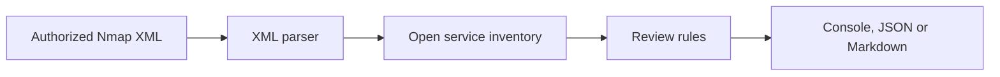

# Network Reconnaissance Report Analyzer

**Type:** Offline analysis of synthetic Nmap XML. No scanning is performed by this code.

## Purpose
Parse an Nmap XML report, summarize hosts and open services, and identify potential review items such as exposed Telnet or FTP. This is an observation tool: an open port alone is not proof of a vulnerability.

## Run

```bash
python analyze_nmap.py samples/authorized_lab.xml
python analyze_nmap.py samples/authorized_lab.xml --json
python analyze_nmap.py samples/authorized_lab.xml --markdown inventory-report.md
python -m unittest discover -s tests -v
```

## Expanded offline packet analysis

`pcap_workbench.py` adds a **classic PCAP** reader for Ethernet / IPv4 traffic, identifying TCP, UDP, and ICMP, top source addresses, destination ports, and simple flow summaries. It parses existing captures; it does **not** scan or sniff the network. Unsupported formats (including PCAPNG) must be converted with an authorized tool or analyzed separately.

Create a three-packet fictional fixture and analyze it:

```bash
python generate_sample_pcap.py synthetic.pcap
python pcap_workbench.py synthetic.pcap
python pcap_workbench.py synthetic.pcap --format json --output packet-report.json
python pcap_workbench.py synthetic.pcap --format markdown --output packet-report.md
python -m unittest discover -s tests -v
```

This expansion adds five tests for protocol classification, ports, flow summaries, markdown output, and invalid capture headers; eight Python tests now cover both tools. The generator uses documentation-only addresses and writes no real traffic. Never commit live network captures containing personal or organizational information.

## Sample findings

The **fictional** example contains a host with TCP ports 22 (SSH), 80 (HTTP), and 23 (Telnet) open. The analyzer recommends reviewing whether Telnet is necessary and enforcing encrypted remote administration. Another host exposes TCP 443 (HTTPS). These are hypothetical inventory observations, not real scanned machines.

## Architecture



### Review record — NET-001

| Field | Observation |
|---|---|
| Source | Synthetic XML, host `192.0.2.10` |
| Port/service | TCP 23, Telnet |
| Assessment | Service merits manual review; not a proven vulnerability |
| Potential concern | Telnet generally lacks encrypted session transport |
| Recommendation | Disable if unneeded; use encrypted remote administration |
| Verification | Parser test confirms the review note is emitted |

## Reproduce with an owned lab (optional)

If Alexander has Nmap installed, he may scan **only a host he owns or has explicit permission to test** and export XML:

```bash
nmap -sT -sV -oX authorized_lab.xml 127.0.0.1
python analyze_nmap.py authorized_lab.xml
```

Do not publish IP addresses, hostnames, banners, or service versions from a real business network. For a Wireshark extension, capture traffic solely on an authorized lab interface, explain DNS/TCP/TLS packet metadata, and share redacted screenshots rather than raw private packet captures.

## Evidence checklist

- [ ] Reproduce parser results on bundled synthetic XML
- [ ] Explain difference between open service and confirmed vulnerability
- [ ] Optionally capture permissioned local-lab Nmap results and redact them
- [ ] Add sanitized Wireshark protocol analysis as future enhancement
